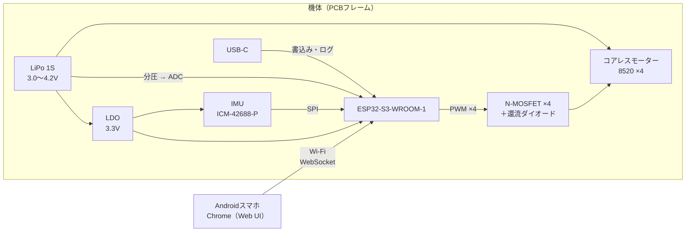
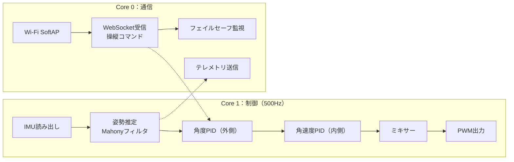

# 02 システム構成

| 版 | 日付 | 内容 |
|---|---|---|
| 0.1 | 2026-11-01 | 初版（たたき台） |

## 1. 全体ブロック図

## 2. 電源系統

| 系統 | 電圧 | 負荷 | 備考 |
|---|---|---|---|
| VBAT | 3.0〜4.2V | モーター ×4（ピーク約10A） | 太いパターンで直結 |
| 3V3 | 3.3V | ESP32-S3（ピーク約0.5A）、IMU | 低ドロップアウトのLDOを使う |

**リスク**：モーターに大電流が流れると電池電圧が下がり、LDOの入力が3.3V付近まで落ちてESP32がブラウンアウト（電圧低下によるリセット）する可能性がある。
**対策案**：ドロップアウトの小さいLDOを選ぶ、大容量コンデンサを入れる、低電圧で出力を絞る（REQ-F04）。Phase 1の実測で判断し、必要なら昇降圧DC-DCも検討する。

## 3. ファームウェア構成（予定）

ESP32-S3はデュアルコアなので、通信処理（Core 0）と制御ループ（Core 1）を別のコアに分け、Wi-Fi処理による制御周期の乱れを防ぐ（[ADR-0002](adr/0002-mcu-esp32-s3.md)）。

## 4. バジェット（推定値）

`python tools/budget.py` の出力。部品が届いたら実測値に置き換えて更新する。

### 重量

| 項目 | 単重 [g] | 個数 | 小計 [g] | 根拠 |
|---|---:|---:|---:|---|
| PCBフレーム (FR4 1.0mm) | 6.0 | 1 | 6.0 | 面積から概算 |
| ESP32-S3-WROOM-1 | 3.5 | 1 | 3.5 | データシート寸法から概算 |
| IMU・MOSFET・受動部品 | 1.0 | 1 | 1.0 | 概算 |
| モーター 8520 コアレス | 5.0 | 4 | 20.0 | 販売ページ値、要実測 |
| プロペラ 55mm | 0.5 | 4 | 2.0 | 販売ページ値、要実測 |
| LiPo 1S 500mAh | 12.0 | 1 | 12.0 | 販売ページ値、要実測 |
| プロペラガード (PLA) | 1.5 | 4 | 6.0 | CAD体積×密度で後日更新 |
| 配線・コネクタ・バッテリー固定 | 2.0 | 1 | 2.0 | 概算 |
| **合計** | | | **52.5** | |

### 推力・電力・寸法

| 項目 | 値 | 要求 | 判定 |
|---|---:|---:|:---:|
| 総重量 | 52.5 g | ≤ 60 g | OK |
| 最大推力 | 120 g | - | - |
| 推力重量比 | 2.29 | ≥ 2.0 | OK |
| ホバリングスロットル（概算） | 44 % | - | - |
| ホバリング電流 | 4.20 A | - | - |
| 飛行時間 | 5.7 分 | ≥ 4 分 | OK |
| ピーク電流 | 10.5 A | ≤ 電池許容 12.5 A | OK |
| 隣接モーター間距離 | 70.7 mm | - | - |
| ガード外径 | 62.4 mm | - | - |
| ガード同士の隙間 | 8.3 mm | > 0 mm | OK |
| 外形（ガード込み） | 133.1 mm 角 | ≤ 150 mm | OK |

**所見**：推力重量比2.29は要求を満たすが、余裕は小さい。重量が60gに近づくと2.0を切るため、重量管理が最重要。推力値（30g/個）は推定値なので、Phase 1の推力試験で最優先に確かめる。
